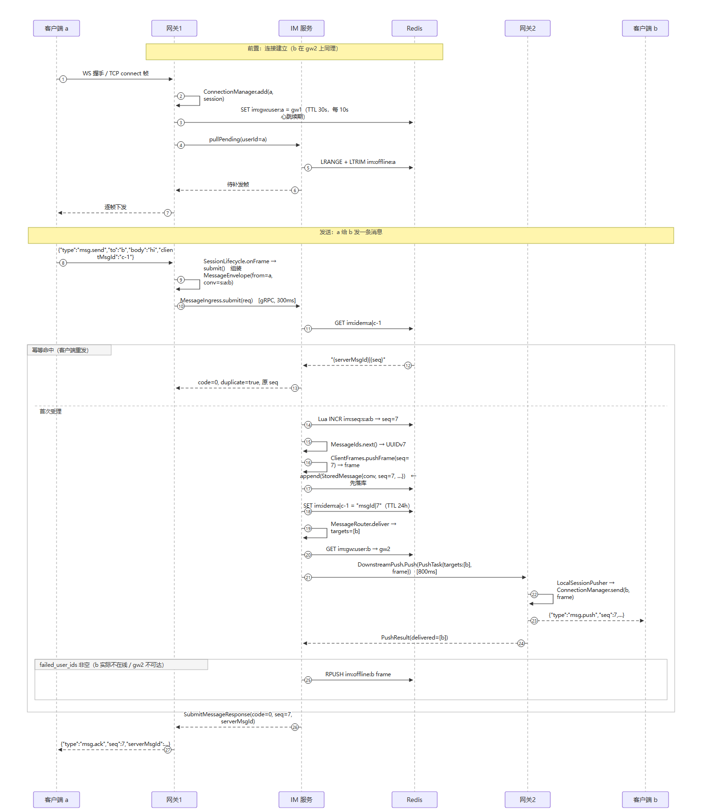
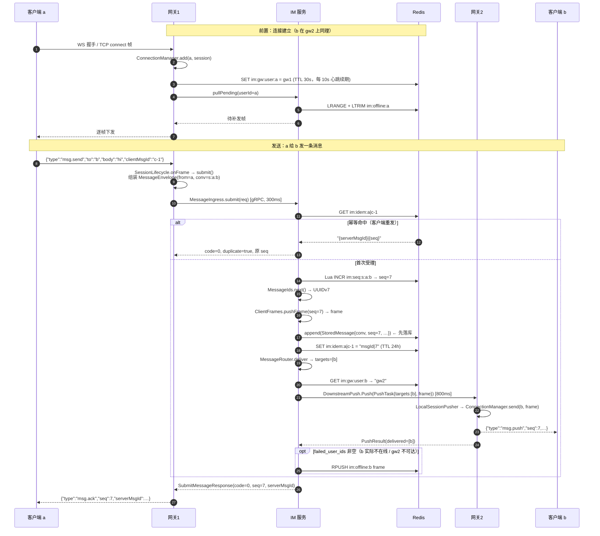

# 消息投递调用流程（a 连网关1、b 连网关2）

> 场景：网关与 IM 服务**分开部署**（`im-gateway-boot` × 2 + `im-server-boot`），用户 a 的长连接在网关1，用户 b 的长连接在网关2。
> 单体部署（`im-app`）的差异见文末第 8 节。

| 项 | 值 |
|---|---|
| 上行超时 | `im.server.timeout-ms`，默认 300ms |
| 下行超时 | `im.push.timeout-ms`，默认 800ms |
| 网关下行 gRPC 服务 | `im.push.v1.DownstreamPush` |
| IM 上行 gRPC 服务 | `im.ingress.v1.MessageIngress` |

---

## 1. 总览（部署视角）

```
┌──────────┐    WS/TCP     ┌───────────────────── 网关1 (im-gateway-boot) ─────────────────────┐
│ 客户端 a │──────────────▶│ NettyGatewayServer → Tcp/WebSocketFrameInboundHandler              │
└────▲─────┘               │ → SessionLifecycle.onFrame() → submit()                          │
     │                     └───────────────┬──────────────────────────────────────────────────┘
     │                                     │ ① MessageIngress.submit(req)  gRPC deadline 300ms
     │                                     ▼
     │          ┌────────────────── IM 服务 (im-server-boot) ─────────────────┐
     │          │ MessageIngressGrpcService.submitMessage()                    │
     │          │        ▼                                                     │
     │          │ MessageService.submit()                                      │
     │          │   1. GET  im:idem:{a}|{clientMsgId}   ── 命中 → 直接回放 ──┐ │
     │          │   2. SeqAllocator.next(conv) → Lua INCR im:seq:{conv}      │ │
     │          │   3. MessageIds.next()       → UUIDv7（与 seq 解耦）        │ │
     │          │   4. ClientFrames.pushFrame()→ 下行帧 JSON（网关不解析）    │ │
     │          │   5. MessageRepository.append()   【write-ahead：先落库】    │ │
     │          │   6. SET  im:idem:…（TTL 24h）                              │ │
     │          │   7. MessageRouter.deliver() → 目标列表 [b]                 │ │
     │          └───────────────┬────────────────────────────────────────────┘ │
     │                          │ ② PushPort.push(PushTask{targets:[b], frame}) │
     │                          ▼                                              │
     │          ┌──── im-rpc RemoteGatewayPushPort ────┐                        │
     │          │ 读 im:gw:user:b → "gw2"，按实例分组   │                        │
     │          │ gRPC DownstreamPush.Push (800ms)    │                        │
     │          └───────────────┬─────────────────────┘                        │
     │                          ▼                                              │
     │          ┌────────────── 网关2 (im-gateway-boot) ────────────┐           │
     │          │ DownstreamPushGrpcService.push()                  │           │
     │          │   → LocalSessionPusher.push()                     │           │
     │          │     → ConnectionManager.send(b, frame)            │           │
     │          └───────────────┬───────────────────────────────────┘           │
     │                          ▼                                               │
     │                    客户端 b  ◀── {"type":"msg.push","seq":7,…}           │
     │                                                                          │
     └──── {"type":"msg.ack","seq":7} ──── 网关1 ◀── SubmitMessageResponse ─────┘
```

要点：**网关不存消息、不做离线判定**；消息的写入、发号、路由决策、离线兜底全部在 IM 服务侧。

---

## 2. 方法级时序图



> 图片由同目录的 `sequence-a-to-b.svg` 渲染（矢量图，可无损放大）。流程有改动时改下面的 Mermaid 源码后重新出图即可。

<details>
<summary>Mermaid 源码（支持 Mermaid 的编辑器/平台可直接渲染，如 GitHub、IDEA 2023.1+）</summary>



</details>

---

## 3. 分步调用清单

| # | 发起方 | 调用 / 动作 | 说明 |
|---|---|---|---|
| 1 | 客户端 a | 发送 `{"type":"msg.send","to":"b","body":"hi","clientMsgId":"c-1"}` | WS 文本帧或 TCP 长度帧 |
| 2 | 网关1 | `SessionLifecycle.onFrame()` | 按 `type` 分派：`ping` / `pong` / `sync` / `msg.send`；未知类型显式报 400 |
| 3 | 网关1 | `SessionLifecycle.submit()` | 组装 `MessageEnvelope`；缺省字段补全（`clientMsgId`=UUID，单聊 `conv`=`s:a:b` 且双方排序后再拼） |
| 4 | 网关1 → IM | `MessageIngress.submit(req)` | 独立部署时实现为 `RemoteMessageIngress`，gRPC + 300ms deadline + `round_robin` |
| 5 | IM 服务 | `MessageIngressGrpcService.submitMessage()` | 上行 gRPC 入口，直接交给本地 `MessageService` |
| 6 | IM 服务 | `MessageService.submit()` | 幂等判定 → 发号 → 生成 ID → 序列化帧 → 落库 → 写幂等 → 路由 |
| 7 | IM 服务 | `SeqAllocator.next(conv)` | Lua 原子 `INCR im:seq:{conv}`，返回值即全局一致的会话内顺序 |
| 8 | IM 服务 | `MessageIds.next()` | UUIDv7，与 seq 解耦（seq 回绕不会撞 ID） |
| 9 | IM 服务 | `ClientFrames.pushFrame()` | 生成下行帧字符串，网关**原样透传不解析** |
| 10 | IM 服务 | `MessageRepository.append()` | write-ahead：先落库再推送，抛异常则整条受理失败 |
| 11 | IM 服务 | `redis SET im:idem:…`（TTL 24h） | 存 `serverMsgId|seq`，用于幂等回放 |
| 12 | IM 服务 | `MessageRouter.deliver()` | 只算“投给谁”：单聊 `[b]`；群聊查成员去掉发送者 |
| 13 | IM 服务 | `PushPort.push(PushTask)` | 独立部署实现为 `RemoteGatewayPushPort` |
| 14 | IM 服务 | `GET im:gw:user:b` → `gw2` | 按目标实例分组，逐实例推送 |
| 15 | IM → 网关2 | `DownstreamPush.Push` | gRPC，800ms deadline；失败/超时**不抛异常**，记 `failed_user_ids` |
| 16 | 网关2 | `DownstreamPushGrpcService.push()` → `LocalSessionPusher.push()` → `ConnectionManager.send(b, frame)` | 只找本机会话写帧，找不到即失败 |
| 17 | 客户端 b | 收到 `{"type":"msg.push","seq":7,…}` | — |
| 18 | IM → 网关1 | `SubmitMessageResponse(code=0, seq, serverMsgId)` | — |
| 19 | 网关1 → a | `{"type":"msg.ack","seq":7,"serverMsgId":…}` | 失败时回 `error`（503 = 可重试） |

---

## 4. 代码位置索引

| 动作 | 文件与位置 |
|---|---|
| 收帧与 `type` 分派 | `im-gateway/src/main/java/com/github/im/gateway/transport/SessionLifecycle.java` · `onFrame()` 81-117 |
| 组装信封并调上行 | 同上 · `submit()` 135-174 |
| 上行 gRPC 服务端 | `im-server/src/main/java/com/github/im/server/grpc/MessageIngressGrpcService.java` 34-39 |
| 受理主流程 | `im-server/src/main/java/com/github/im/server/message/MessageService.java` 91-118 |
| 发号器 | `im-server/src/main/java/com/github/im/server/message/SeqAllocator.java` 108-120 |
| 路由决策 | `im-server/src/main/java/com/github/im/server/message/MessageRouter.java` 40-64 |
| 下行远程推送 | `im-rpc/src/main/java/com/github/im/rpc/push/RemoteGatewayPushPort.java` 51-90 |
| 下行 gRPC 服务端 | `im-gateway/src/main/java/com/github/im/gateway/push/DownstreamPushGrpcService.java` 25-29 |
| 本机会话写帧 | `im-gateway/src/main/java/com/github/im/gateway/push/LocalSessionPusher.java` 27-41 |
| 会话查找与发送 | `im-gateway/src/main/java/com/github/im/gateway/session/ConnectionManager.java` 100-103 |
| 在线路由登记与续期 | `im-gateway/src/main/java/com/github/im/gateway/session/GatewayRegistry.java` · `bindUser()` / `heartbeat()` 62-70 |
| 离线队列 | `im-server/src/main/java/com/github/im/server/message/OfflineMessageStore.java` 27-43 |
| 上行客户端（网关侧） | `im-rpc/src/main/java/com/github/im/rpc/ingress/RemoteMessageIngress.java` 51-69 |
| 上行装配 | `im-gateway-boot/src/main/java/com/github/im/gatewayboot/GatewayWiring.java` 80-92 |
| 下行装配（IM 侧） | `im-server-boot/src/main/java/com/github/im/serverboot/ServerWiring.java` 29-35 |

---

## 5. 贯穿全程的 Redis key

| key | 写方 | 读方 | 作用 |
|---|---|---|---|
| `im:gw:user:{userId}` | 网关（连接建立时写，每 10s 续期，TTL 30s） | IM 服务 | 在线路由：userId → 网关实例 ID |
| `im:seq:{conversationId}` | IM 服务（Lua `INCR`） | IM 服务 | 会话内 seq 发号计数 |
| `im:conv:msgs:{conversationId}` | IM 服务（`im.storage=redis` 时） | IM 服务 | 消息存储（生产用 MySQL，`im.storage=jdbc`） |
| `im:idem:{from}\|{clientMsgId}` | IM 服务 | IM 服务 | 幂等表，TTL 24h，值为 `serverMsgId\|seq` |
| `im:offline:{userId}` | IM 服务（推送失败时） | IM 服务 | 离线帧队列（FIFO） |

---

## 6. 关键设计取舍

- **网关无消息状态**：网关1 只做「解帧 → 交上行 → 回 ack」，网关2 只做「按 userId 找本机会话写帧」；找不到就如实返回失败，是否离线由 IM 服务判定。
- **在线状态与业务分离**：`MessageRouter` 只计算目标用户，不查在线；在线判定下沉到网关的 `GatewayRegistry.instanceOf()`。
- **先落库后推送**（write-ahead）：`append` 在 `deliver` 之前，不存在「b 收到但库里没有」；落库失败即整体失败。
- **帧由 IM 服务序列化，网关不解析**：新增业务字段不需要改网关。
- **失败不抛异常**：`PushPort` 的实现（`RemoteGatewayPushPort` / `GatewayPushPort`）永不把异常抛给 IM 服务，一律转成 `failed_user_ids`，由 IM 服务统一落离线 —— 可丢实时性，不可丢消息。
- **seq 与 ID 解耦**：`seq` 只保证会话内单调（可能有洞），唯一性交给 UUIDv7。

---

## 7. 失败分支与补救

| 故障点 | 网关1 给 a 的响应 | 补救 |
|---|---|---|
| IM 服务不可用 / 超 300ms | `error 503`（连接**不断**，客户端退避重发） | 重发后靠 `im:idem` 幂等，不会重复落库 |
| `im:gw:user:b` 查不到（b 离线） | 正常 `ack` | `failed` → `RPUSH im:offline:b`，b 上线 `pullPending` 补发 |
| 网关2 不可达 / 下行超 800ms | 正常 `ack` | 同上，落离线队列 |
| 客户端重复提交 | `ack`，`duplicate=true`，返回**原 seq** | 幂等表命中，不重复落库、不重复推送 |
| 落库异常（含唯一索引冲突） | `error 503` | 可重试；唯一索引 `uk_msg_conv_seq` / `uk_msg_idem` 兜底 |
| 网关1 宕机（已受理但未回 ack） | 无响应，客户端重连重发 | 幂等表命中，返回原 `seq` |

---

## 8. 注意事项与单体差异

### 8.1 上下行超时的时序耦合

下行推送发生在 `submit` 的**同步路径**里（gw1 → IM → gw2 → b 全部串完才回 ack），而下行超时默认 800ms 大于上行超时默认 300ms。

若网关2 处于“网络黑洞”状态（不是快速拒绝，而是无响应），a 会先拿到 503，但消息其实已落库、b 最终也能收到 —— 表现为 **a 认为失败而重发、服务端幂等去重**。语义正确，只是多一次客户端重试。

要彻底消除这个窗口，需要把下行推送移出 ack 关键路径（受理后异步投递 + outbox）。

### 8.2 单体部署（`im-app`）的差异

链路形状不变，只是两处端口实现被替换：

| 端口 | 独立部署 | 单体部署（`im-app`） |
|---|---|---|
| `MessageIngress`（上行） | `RemoteMessageIngress`（gRPC 300ms） | 本地 `MessageService` 直调 |
| `PushPort`（下行） | `RemoteGatewayPushPort`（gRPC 800ms） | `GatewayPushPort`：本机有会话则 `LocalSessionPusher` 直推，否则 gRPC 转给其它网关实例 |

即单体形态下少一次 IM ↔ 网关 的跨进程往返，其余顺序、幂等、发号、离线兜底完全相同。
